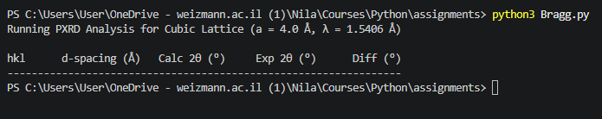

# Day 3 Assignment: Powder X-Ray Diffraction (p-XRD) Bragg Peak Calculator

## Overview
This script computes the theoretical interplanar spacings ($d$-spacings) and Bragg diffraction angles ($2\theta$) for a cubic crystal lattice with a known lattice parametes (a= 4 Å) and compares them against experimental diffraction data loaded from a CSV file.

## Prompts used:

### Ask gemini in chrome:
* suggest fitting computations fiting for assignment 3
* generate data for the Bragg code
* how do i open a terminal in visual studio code
* how do i run th py code?
* in the code you gave me, do i need to write the specific name of the csv file that needs to be imported if it’s in the same folder??
* how do i test the code is working? (DIDNT WORK)
* this is what i got


### chat copilot in VSC:
* check if diffraction_data.csv can be read in Bragg code


## Files Included
* **`Bragg.py`**: The core Python script containing functions to parse the dataset, compute crystallographic parameters via Bragg's Law, and output a formatted comparison table.
* **`diffraction_data.csv`**: A structured comma-separated data file containing Miller indices ($h, k, l$) and experimental $2\theta$ diffraction angles.

## Scientific Computations Performed
1. **Interplanar Spacing ($d$):** Calculates the $d$-spacing for a cubic crystal system given lattice parameter $a$:
   $$d = \frac{a}{\sqrt{h^2 + k^2 + l^2}}$$

22. **Bragg's Law & Detector Angles ($2\theta$):** Computes the theoretical diffraction peak positions using copper $K\alpha$ radiation wavelength ($\lambda = 1.5406$ Å): 
   $$\sin\theta = \frac{\lambda}{2d}$$
   $$2\theta_{\text{calc}} = 2 \times \arcsin(\sin\theta)$$

3. **Error Analysis:** Computes the residual difference ($\Delta 2\theta = 2\theta_{\text{calc}} - 2\theta_{\text{exp}}$) to evaluate the match between theoretical model predictions and experimental observations.

## How to Run
Navigate to the `day03` folder in your terminal and execute:
```bash
python3 Bragg.py
