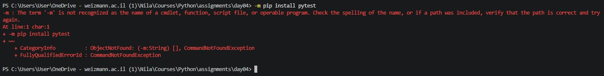
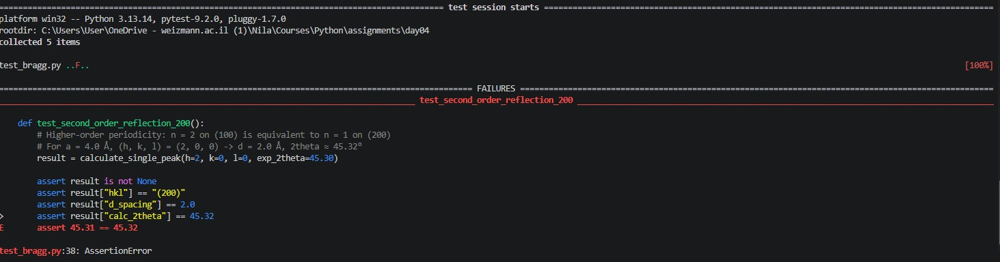

## Unit Tests (`test_bragg.py`)

Automated tests were added using `pytest` to verify the standalone crystallography calculation logic (`calculate_single_peak`) in `Bragg.py`.

### How to Run the Tests

1. Install `pytest` (if not already installed):
   ```bash
   python -m pip install pytest

   ### What Each Test Verifies
   
2. Run the test suite from the day04 directory:
   python -m pytest -v

* **`test_calculate_single_peak_standard`**:
  Tests the baseline `(100)` cubic reflection (`a = 4.0 Å`, `λ = 1.5406 Å`) with an experimental peak at `22.00°`, confirming the formatted `"(100)"` label, `d = 4.0 Å`, calculated `2θ = 22.21°`, and positive difference (`0.21`).
* **`test_calculate_single_peak_111`**: 
  Tests a multi-index `(111)` reflection (`h² + k² + l² = 3`) with an experimental peak at `39.00°`, verifying rounded irrational d-spacing (`2.3094 Å`), calculated `2θ = 38.97°`, and negative residual handling (`-0.03`).
* **`test_second_order_reflection_200`**:
  Verifies higher-order Bragg periodicity (`n = 2` on `(100)`, represented crystallographically as first-order `n = 1` on `(200)`), confirming that `d` halves to `2.0 Å` and yields `2θ = 45.31°` (`diff = 0.01` against `exp_2theta = 45.30`).
* **`test_zero_miller_indices_returns_none`**: 
  Verifies that passing invalid Miller indices `(0, 0, 0)` returns `None` rather than raising a `ZeroDivisionError`.
* **`test_unphysical_reflection_returns_nan`**:
   Verifies that when `λ > 2d` (`sin(θ) > 1`, so no physical Bragg reflection exists), the function returns `NaN` for `calc_2theta` and `diff` instead of raising a math domain error.


### AI prompt:

#### Ask gemini:
* how do i do the assignment for day 05 
* how do i make sure my code is standalone?
* this is my code, what do i write in the test file?
* this is what it says 
* what did this test do?
* what about periodicity of lamda (n*lambda) this is physical
* add it to the code
* the test suddenly failed
 
* explain each test in the code
* write it for a readme file

#### Chat in VSC:
* is Bragg.py, app.py stand alone?
* make it standalone (STILL NEED FLASK INSTALLED, BUT IT WAS REQUIRED IN THE ORIGINAL DAY04 HOMEWORK)
* can i delete the index.html file with no effect on the code?
